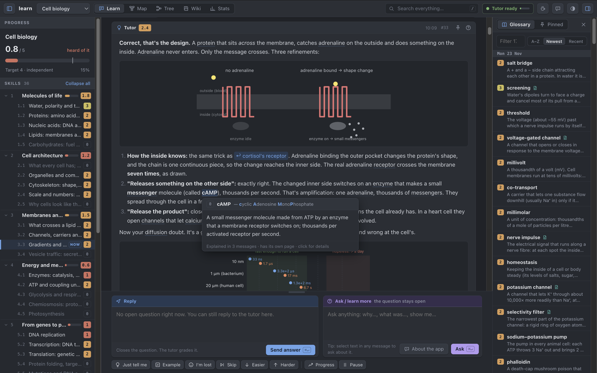

# Socratic tutor

A tutor for anything you want to actually understand. It runs on your machine: Claude Code (or
another coding agent) does the teaching, and a small web page is where you read, answer and look
things up again later.

It started as Jane Street's [socratic-tutor skill](https://github.com/janestreet/agent_skills/blob/master/socratic-tutor/SKILL.md)
for Claude Code. The teaching method is theirs: find out what you know, explain a bit, ask one
question that checks you really got it, and only move on when you did. This repo wraps that in a
UI, keeps everything in files, and lets the agents run the whole thing on their own.



## Run it

```
git clone https://github.com/comboy/socratic-tutor.git
cd socratic-tutor
bin/learn
```

You need Node 22+ and [Claude Code](https://claude.com/claude-code), installed and logged in.
No npm install, no build. If something's missing, `bin/learn` says what. If you don't feel like
sorting it out yourself, open your coding agent in this folder and tell it: *read docs/setup.md
and get this running*.

## What it's like

You say what you want to learn and why. The tutor asks a couple of questions to see where you
are, builds a skill tree for the topic, then goes a chunk at a time: explain, ask one question,
grade the answer. Skill levels only go up when you show it.

On the way it draws diagrams, pulls in real images, keeps a glossary of every term it used
(hover any underlined word) and writes wiki pages about what you covered, in terms of what you
already know. Everything is plain files in `data/` (its own git repo), so you can close it any time
and pick up where you left off.

When you leave, hit **I'm going away**. Agents use the time to review your sessions for gaps and
misunderstandings, catch up on the wiki, and work through the feedback you left about the app
(the gear button). Yes, that means it changes its own code. That's the point: it's a
frontier coding agent sitting in your terminal, so it might as well make the tool fit how you
learn.

## Good to know

- The agents run in Claude Code's auto mode: no permission prompts (nobody's watching the
  terminal), and Claude Code blocks the risky stuff. It all runs on your own Claude subscription.
- The background jobs commit their app changes to your clone. Your learning data stays in `data/`.
- Built and used on macOS. Linux should be fine.
- The details (every button, where data lives, other agents, config, tests) are in
  [docs/how-it-works.md](docs/how-it-works.md). Agents start at [AGENTS.md](AGENTS.md).

## License

MIT, see [LICENSE](LICENSE). Do whatever you want with it. The teaching method comes from Jane
Street's MIT-licensed skill, so their notice is in there too.
